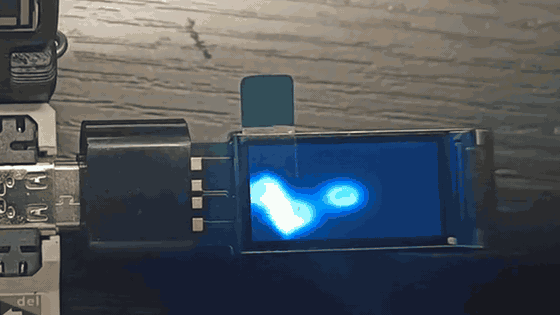
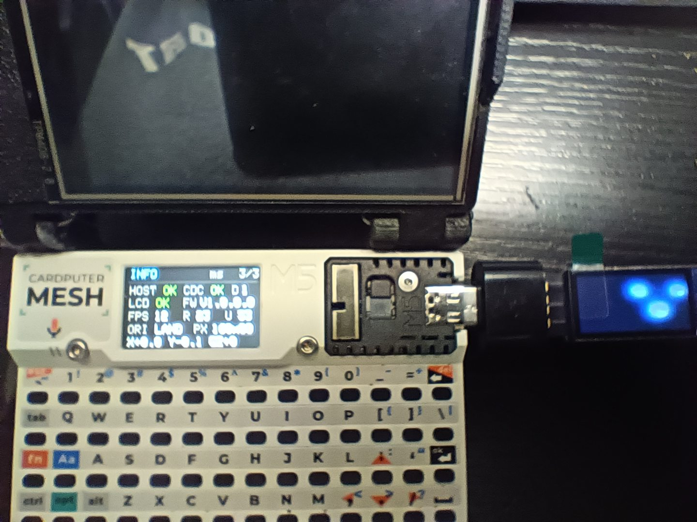
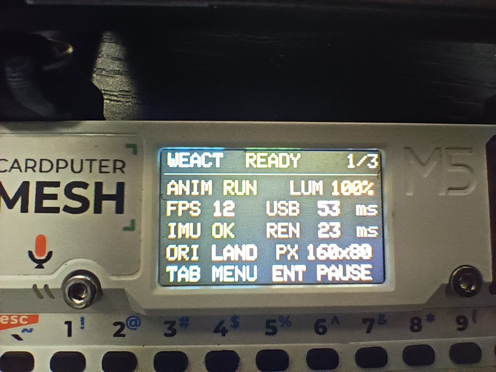
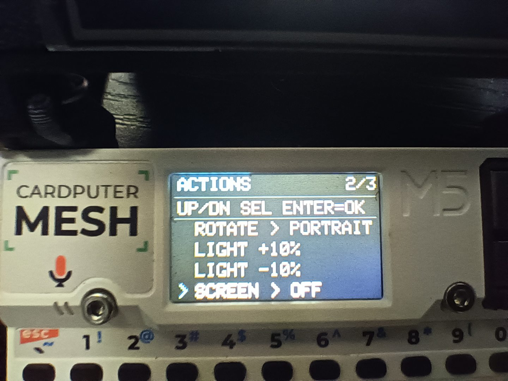
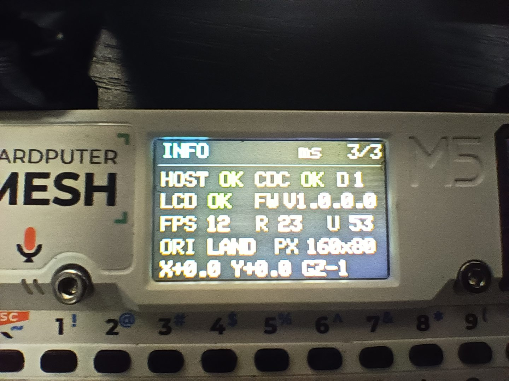
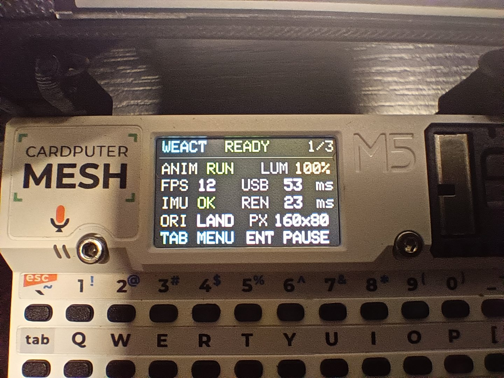

# Cardputer ADV + WeAct USB Display

Control a WeAct Studio Display FS V1 0.96-inch USB-C screen from an M5Stack Cardputer ADV. Rotate the display, adjust its brightness, and run an RGB565 animation that reacts to movement and telemetry.

This DIY project includes a reusable C++ display library, an Arduino demo with on-device controls, and a complete 8 MiB firmware image.

▶️ [Watch the full 9-second video (landscape MP4, ~1 MB)](media/cardputer-weact-animation.mp4)

## 📦 Choose what you need

| I want to... | Start here |
| --- | --- |
| Use the display in my own project | [WeActUSBDisplay library](library/WeActUSBDisplay/) · [API reference](docs/LIBRARY_API.md) |
| Explore or modify the Cardputer demo | [Demo source](demo/CardputerADV_WeActDemo/) · [Build guide](docs/BUILD.md) |
| Install the ready-made demo | [Firmware](firmware/) · [Flash instructions](docs/FLASH.md) |

To generate separate library, demo-source, and firmware ZIPs, run `python tools/package_release.py`.

## 🎛️ The demo

The Cardputer's built-in TFT has three pages: **Dashboard**, **Actions**, and **Info**. Use its keyboard to control the external WeAct screen.

| Key | Dashboard / Info | Actions |
| --- | --- | --- |
| `TAB` | Switch page | Switch page |
| `UP` / `DOWN` | Change brightness by 10% | Select a command |
| `ENTER` | Pause or resume the animation | Run the selected command |
| Other printable key | Trigger a pulse on Dashboard | — |

The fluid animation responds to the Cardputer's BMI270 motion sensor. Measured FPS, rendering time, and USB transfer time also change its shape, color, and speed through pseudo-random 80/10/10 weighting. These are creative effects, **not** a CPU-load visualization. The microphone is unused.

The `ROTATE` action cycles through landscape, portrait, reverse landscape, and reverse portrait. The animation keeps its proportions in portrait; the display handles reversed orientations. Brief colored corner markers indicate direction. Each update sends a full logical RGB565 frame.

Start with the [quick guide](docs/QUICKSTART.md), or open [troubleshooting](docs/TROUBLESHOOTING.md) if the panel does not connect.

### 📸 Hardware and interface

| Dashboard | Actions |
| --- | --- |
|  |  |
| Info | Dashboard, wider view |
|  |  |

## 🔌 Supported hardware

You need an **M5Stack Cardputer ADV** (ESP32-S3, 8 MiB flash), a **WeAct Display FS V1 0.96-inch** panel, and a data-capable USB-C connection.

The observed panel uses USB CDC, VID:PID `1A86:FE0C`, firmware `V1.0.0.0`, and RGB565 pixels. It supports **160×80** landscape and **80×160** portrait, including reversed orientations.

The library supports orientation, brightness, screen power, solid-color fills, and rectangular pixel drawing. Partial solid fills, FastLZ, and the `Free` command still need physical validation. See [hardware compatibility](docs/HARDWARE.md) and [protocol details](docs/PROTOCOL.md).

## 🛠️ Build and verify

The demo uses Arduino-ESP32 3.3.2, EspUsbHost 2.10.1, and M5Stack libraries. The [build guide](docs/BUILD.md) covers the toolchain. Native tests check the driver protocol and demo logic; `tools/verify_release.py` checks the firmware hashes, 8 MiB image layout, erased NVS, and Arduino core source archive.

**Flashing the factory image at `0x0` overwrites the Cardputer's entire 8 MiB flash**, including settings. Follow the [flash guide](docs/FLASH.md) before installing it.

The telemetry/rotation demo has been reported working on a Cardputer ADV. That test was not tied to a readback of the exact image distributed here, so hardware acceptance of this binary, including all four orientations, is still pending. See the [firmware manifest](firmware/manifest.json) and [validation record](docs/VALIDATION.md).

## License and attribution

This independent project is unaffiliated with M5Stack or WeAct Studio. Its original source and documentation use the [MIT license](LICENSE). The prebuilt firmware also contains separately licensed components, including LGPL-covered Arduino-ESP32 code.

The repository includes the [corresponding Arduino core source snapshot](sources/README.md) and [third-party notices](THIRD_PARTY_NOTICES.md) for redistribution.
